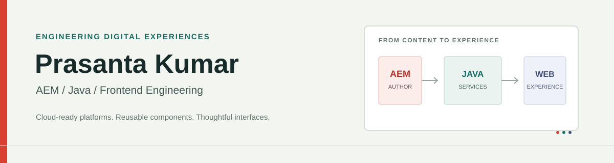

	

	

		
		
		
	

## Senior AEM Developer & Frontend Engineer

I build content-rich digital experiences, from cloud-ready Adobe Experience Manager platforms and reusable component systems to modern web frontends. I enjoy working across the stack: shaping maintainable Java and Sling foundations, making authoring intuitive, and bringing the final experience together in the browser.

## What I Work On

- **AEM platforms:** AEM as a Cloud Service, Sling Models, OSGi, HTL, Core Components, and Maven-based delivery.
- **Component engineering:** reusable authorable components, clear content structures, and practical documentation.
- **Modern web:** TypeScript, JavaScript, React, Next.js, responsive interfaces, and AEM headless patterns.
- **Delivery:** REST APIs, Git/GitHub workflows, and automated build validation.

## Selected Work

| Project | What it demonstrates |
| --- | --- |
| [AEM Component Library](https://github.com/Prasanta-Kumar-code/aem-component-library) | AEM as a Cloud Service accelerator with Java 17, Sling Models, HTL, OSGi, Core Components, and reusable author-facing components. |
| [McDelivery AEM Platform](https://github.com/Prasanta-Kumar-code/mcdelivery-aem-platform) | A McDelivery-inspired headless experience pairing AEM with a Next.js frontend and local-first development. |
| [Developer Portfolio](https://github.com/Prasanta-Kumar-code/prasanta-kumar-khatei-portfolio) | A Next.js 15 portfolio built as a static site for GitHub Pages. |
| [AI Resume Generator (POC)](https://github.com/Prasanta-Kumar-code/AI_Powered_POC) | A React and Tailwind interface for shaping resume drafts, with PDF and plain-text export. AI provider integration is still future work. |

## Toolbox

**AEM & Java** 

**Frontend** 

## Let’s Connect

Interested in AEM engineering, component architecture, or frontend collaboration? [Connect on LinkedIn](https://www.linkedin.com/in/prasanta-kumar-khatei-b03b66220/) or [send me an email](mailto:prasantkumarkhatei9@gmail.com).
